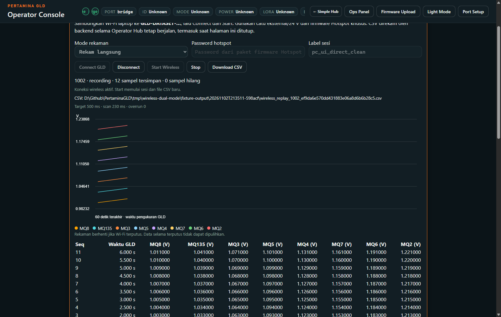
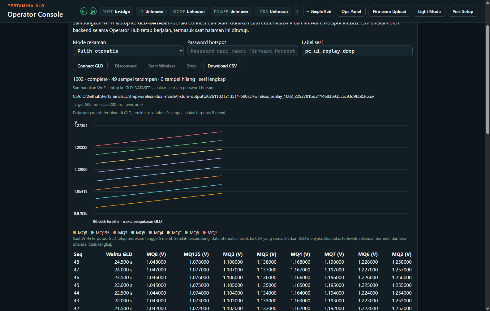

# Dataset Wireless: dua mode pada firmware hotspot yang sama

Tanggal: 2026-11-02, Asia/Jakarta. Status: perbaikan aplikasi dan pengujian PC selesai; pengujian adapter terbaru pada GLD asli ditunda sesuai permintaan pengguna. Tidak ada akses COM7, perubahan Wi-Fi Windows, compile, upload, reset NVS atau perubahan firmware pada kelanjutan ini.

## Cara memakai

1. Saat perangkat tersedia, nyalakan GLD dengan catu eksternal/24 V dan firmware hotspot tahap 2 yang sudah disiapkan. Sambungkan laptop ke hotspot GLD. Hotspot tidak menyediakan Internet.
2. Buka [Operator Hub lokal](http://127.0.0.1:5173/), masuk konsol GLD, lalu tab **Dataset**. Konsol juga tersedia di [port 5174](http://127.0.0.1:5174/).
3. Pilih mode, isi password hotspot dan label sesi, klik **Connect GLD**, lalu **Start Wireless**. Grafik menampilkan MQ8, MQ135, MQ3, MQ5, MQ4, MQ7, MQ6 dan MQ2, target satu sampel lengkap setiap 500 ms.
4. Klik **Stop**, tunggu konfirmasi selesai, lalu **Download CSV**. Backend harus tetap berjalan selama merekam.

| Mode | Jika koneksi terputus | Memulai sesi berikutnya |
|---|---|---|
| **Rekam langsung** | CSV, jumlah sampel dan grafik sesi lama berhenti bertambah; sesi ditandai tidak lengkap. Data setelah putus tidak dimasukkan kembali ke CSV tersebut. | Hub menyambung kembali hanya untuk menutup sesi GLD yang sama. Sambungkan kembali ke hotspot dan tunggu selesai. **Batal menunggu** menjeda proses ini; isi password dan klik **Selesaikan sesi** untuk melanjutkan. |
| **Pulih otomatis** | GLD menahan data hingga lima menit selama tetap menyala. Setelah tersambung kembali, data masuk ke CSV yang sama dengan timestamp asli. | Tunggu pemulihan dan konfirmasi Stop. Melewati batas retensi/kapasitas membuat sesi tidak lengkap. |

Selama penutupan sesi masih tertunda, tombol Start, perpindahan mode dan akses perangkat lain dikunci. Data penutupan sesi langsung ditulis ke ledger sementara terpisah sebelum diakui ke GLD; data tersebut tidak dipublikasikan ke grafik/CSV operator. Tidak ada Start ulang otomatis setelah hasil perintah tidak diketahui. Perubahan ini berlaku pada aplikasi; protokol firmware dan collector Pulih otomatis tetap sama.

## Hasil pengujian PC

UI Operator, bridge HTTP/SSE, client WebSocket dan file CSV yang dipakai adalah kode aplikasi sebenarnya. Perangkat dan sensor digantikan peer sintetis di loopback. Timestamp akuisisi 500 ms berasal dari clock sintetis; hasil ini tidak membuktikan timing ADC atau radio GLD fisik.

| Pemeriksaan | Hasil |
|---|---|
| Tes Python wireless | 89 lulus, termasuk 24 tes adapter langsung dan 23 tes route |
| Tes UI/model/race Node | Seluruh enam file tes lulus |
| Protokol lama | Satu handshake dan satu Start, delapan baris CSV, seluruh delapan sensor cocok |
| Browser: langsung normal | 12 sampel lengkap; delapan trace grafik dan unduhan CSV cocok |
| Browser: langsung putus | CSV tetap delapan baris; jeda dan lanjut penutupan sesi berhasil; CSV lama identik |
| Browser: sesi langsung berikutnya | Delapan baris lengkap setelah penutupan sesi sebelumnya |
| Browser: pulih otomatis putus | 40 sampel dipulihkan; akhir 49 baris lengkap di CSV/session yang sama, gap dan duplikat nol |
| Verifikasi independen | Delapan sesi: 117 baris publik dan 28 baris ledger privat; semua kolom cocok dengan sampel sintetis asli |
| Unduhan browser | Empat file / 77 baris cocok dengan backend dan sampel asli; normalisasi CRLF saat export diperhitungkan |
| Proteksi baseline | 231 hash source/paket cocok; CSV pengguna sebelumnya yang berisi 62 sampel tidak berubah |

Tes kegagalan mencakup Start ditolak/tidak terkirim/ACK hilang, Stop idempoten, summary mendahului ACK, kehilangan ACK setelah fsync, disk write/flush/close gagal, identitas perangkat/sesi asing, penutupan dibatalkan, dan 603 record privat tertahan. Bug lock perpindahan mode setelah Connect–Disconnect tanpa Start baru juga diperbaiki dan diuji melalui HTTP sebenarnya.

Satu kegagalan tes HTTP disebabkan race Windows saat urllib mengirim body setelah respons penolakan dini. Probe 90 request memastikan penolakan terjadi sebelum parsing atau akses collector. Tes penolakan memakai POST kosong untuk menghindari race transport tersebut, tetap mewajibkan HTTP403 dan tidak ada akses collector; autentikasi aplikasi tidak diubah.

## Screenshot browser simulasi

Kedua gambar berikut memakai sensor sintetis; bukan foto atau pembacaan GLD asli.

## Implementasi dan bukti

- Adapter tambahan: `apps/gld-operator/wireless_dataset_direct.py`, SHA256 `b0843ab897abf3856ecda5f98d445a6144d192cfb9445df0fb59fc7ff9a95ab1`.
- Wiring dan lock aplikasi: `bridge.py`, `js/wireless-dataset.js`, cache versi `20261102-dual-recording`.
- Collector lama `wireless_dataset.py` dan `wireless_dataset_replay.py`, firmware, paket Model 1/2/3, pin dan nulling tetap identik dengan baseline.
- Bukti lokal: `tmp/wireless-dual-mode/final-verification-report.json`, `independent-csv-verification.json`, `browser-output/browser-evidence.json`, `protocol-review.md`, `app-start-receipt.json`.
- Simulator ditutup dan kedua port loopback uji telah ditutup. Hub5173 dan GLD bridge5174 diaktifkan dari source terbaru; health menyatakan `wirelessDirectCompatible=true`, kedua collector disconnected. Tidak ada sambungan perangkat dibuat.

Sisa bukti: ulangi langsung normal/putus/penutupan/sesi berikutnya dan Pulih otomatis putus pada GLD fisik, lalu cocokkan grafik dan unduhan CSV. Pemulihan setelah backend PC crash/restart atau GLD mati/reboot tetap di luar jaminan retensi RAM ini.
