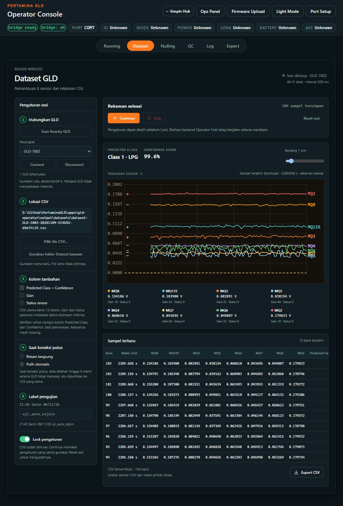

# Manual Dataset Workspace - Operator Hub

Revisi 3 November 2026, setelah uji koneksi GLD1002 Model 2.

Pembaruan host 5 November 2026: kredensial otomatis kini tersedia dari paket
firmware terverifikasi yang ikut Git, tanpa folder build `.pio` pada PC baru.
Upload ketiga model hotspot membaca ID dari COM terpilih, terpisah dari target
Inject ID tersimpan. Lihat [panduan pindah PC](gld-pc-portability.md) untuk pull,
restart Hub yang terlihat dan pemeriksaan paket. Firmware/NVS tidak diubah.

**Manual bergambar yang dipakai:**
[Manual Dataset Workspace - 12 Kolom](../../output/pdf/Manual-GLD-Dataset-Workspace-12-Kolom.pdf)
(15 halaman, screenshot dengan kotak dan nomor petunjuk).
Manual PDF lain yang bernama Wireless, Wizard, 5 Langkah atau Workspace tanpa
akhiran 12-Kolom adalah arsip revisi sebelumnya.
Panduan teks di bawah mencakup tombol folder bawaan, launcher, dan pemulihan
Wi-Fi otomatis per 9 November; screenshot PDF 12-Kolom dibuat sebelum perubahan
tampilan tersebut. Contoh hasil nyata terbaru:

Panel kiri menunjukkan nomor 1–5 dan Lock. Panel kanan atas menunjukkan
**Rekaman selesai** dan jumlah sampel; grafik menampilkan delapan sensor serta
hasil prediksi. Di bawahnya, tabel menunjukkan 10 baris terakhir, status
verifikasi 104 baris, dan tombol **Export CSV**. Pada screenshot ini sesi sudah
ditutup sehingga indikator tidak mengklaim sambungan data masih aktif.

## Paket firmware yang dipilih

Pilih **GLD1** sebagai environment dan salah satu dari tiga paket final:

|Model yang diperlukan|Pilihan upload|
|---|---|
|Model 1|GLD1 Model 1 - Hotspot Wizard Dataset|
|Model 2|GLD1 Model 2 - Hotspot Wizard Dataset|
|Model 3|GLD1 Model 3 - Hotspot Wizard Dataset|

Ketiganya memiliki fitur normal ditambah hotspot; yang berbeda adalah model,
scaler dan kelasnya. Kontrol Running, Nulling dan pengaturan memakai COM;
Dataset memakai Wi-Fi. Pilih model sesuai board/model yang memang digunakan,
bukan berdasarkan angka ID perangkat. GLD1002 terakhir memakai Model 2 atas
pilihan operator. Paket **Model 1/2/3 - Board** biasa tidak menyalakan hotspot
Dataset; enam pilihan hotspot tahap lama sudah digantikan tiga pilihan final.

Gunakan catu eksternal **24 V**, target COM yang benar dan **Reset NVS OFF**.
Tunggu upload terverifikasi dan boot selesai. Ketiga paket final sudah dibuild
paralel dan diperbarui di Hub. Jangan reset, kalibrasi atau bind ulang bila
profil dan binding masih valid.

## Dari hotspot sampai CSV

1. Jalankan `apps/operator-hub/run-operator-hub.bat` di terminal yang terlihat.
   Buka <http://127.0.0.1:5174> di satu tab browser Codex untuk GLD Console,
   lalu tab **Dataset**. Launcher tidak membuka Chrome otomatis. Jika Hub sudah
   berjalan, gunakan instance itu. Jangan membuka backend kedua.
2. Untuk alur Dataset, lepas koneksi serial COM. Klik **Scan Nearby GLD**,
   pilih perangkat yang benar, misalnya **GLD-1002**, lalu **Connect**.
   Hub mengambil password secara otomatis. Jika menyambungkan Wi-Fi Windows
   secara manual, pilih **GLD-DATASET-1002**. Pesan **No Internet** normal:
   hotspot GLD tidak menyediakan internet. Pertahankan Wi-Fi GLD selama sesi.
3. Tunggu indikator **Connected**. Wi-Fi Windows tersambung saja belum cukup;
   Hub masih memeriksa identitas perangkat dan kesiapan layanan data.
4. Klik **Pilih file CSV** untuk menentukan folder dan nama baru lewat dialog
   Windows, atau **Gunakan folder Dataset bawaan** agar aplikasi memberi nama
   unik di `apps/gld-operator/output/datasets`. File lama tidak ditimpa.
   Timestamp label dibuat saat lokasi dipilih.
5. Pilih kolom tambahan. **Predicted Class + Confidence** hanya dapat diaktifkan
   setelah koneksi, lokasi CSV, model, binding dan nulling siap. **Gain** dan
   **Status sensor** opsional; default keduanya tidak dicentang.
6. Pilih satu tombol bulat: **Rekam langsung** atau **Pulih otomatis**.
   Isi kondisi pengujian, misalnya `clear_air_test`. Label lengkap diawali
   `HH:mm Hari dd/mm/yy`, dengan jam 24 jam. Label bukan hasil prediksi.
7. Setelah kelima nomor hijau berurutan, aktifkan **Lock**. Input tetap terlihat
   tetapi tidak dapat diedit; kontrol rekaman muncul.
8. Klik **Start** sekali. Tombol utama berubah menjadi **Pause**, dan **Stop**
   aktif setelah konfirmasi. Grafik delapan sensor dan hitungan tersimpan
   bertambah. Target interval adalah **500 ms**. Prediksi membutuhkan pemanasan
   10 sampel, sekitar 5 detik, setelah Start/Resume.
9. Klik **Pause** untuk menjeda pengukuran setelah GLD mengonfirmasi.
   Tombol berubah menjadi **Resume** untuk melanjutkan sesi yang sama.
10. Klik **Stop**, termasuk ketika Pause. Tunggu seluruh CSV diverifikasi
    terhadap catatan internal; baca popup lalu klik **OK**. Jangan menutup
    backend ketika penutupan/verifikasi belum selesai.
11. **Continue** setelah Stop menambah segmen baru ke CSV yang sama.
    **Resume** melanjutkan sesi yang masih dijeda. Jangan mengedit CSV dari
    aplikasi lain jika akan Continue.
12. Klik **Export CSV** di bawah tabel untuk mengunduh salinan file rekaman.
    File asli sudah tersimpan di lokasi yang dipilih; tabel hanya menampilkan
    10 baris terakhir, sedangkan CSV berisi seluruh baris sesi. Setelah Stop
    terverifikasi, salinan Export identik byte dengan file CSV asli.
13. **Reset sesi** kembali ke pengaturan awal tanpa menghapus CSV atau NVS.
    Reset tidak aktif ketika merekam. Jika sedang Pause, Stop dan verifikasi
    diselesaikan dahulu. Gunakan sesi/file baru untuk konfigurasi baru.
14. Sebelum kembali mengubah pengaturan lewat COM: **Stop**, tunggu verifikasi
    CSV, lalu **Reset sesi**. Jangan mengambil alih sesi yang masih
    merekam, dijeda, pulih atau menunggu penyelesaian.

## Isi CSV

|Pilihan|Jumlah kolom|
|---|---:|
|Default, Gain dan Status OFF|12|
|Gain saja atau Status saja|20|
|Gain dan Status ON|28|

Urutan 12 kolom utama: `Waktu (ms)`, `Label pengujian`, `MQ8 (V)`,
`MQ135 (V)`, `MQ3 (V)`, `MQ5 (V)`, `MQ4 (V)`, `MQ7 (V)`, `MQ6 (V)`,
`MQ2 (V)`, `Predicted Class`, `Confidence`.

Kolom prediksi tetap ada tetapi kosong bila pilihan prediksi OFF atau hasil
belum valid. Confidence bernilai 0..1; misalnya 0,988 berarti 98,8%.
Waktu adalah timestamp GLD dalam milidetik. Gain/Status menambah delapan kolom
per pilihan. Durasi/overrun, identitas perangkat/boot/sesi, urutan sampel,
profil/model dan metadata teknis disimpan internal, tanpa memperbanyak kolom
Excel. CSV dan ledger tetap menjadi dasar ACK serta verifikasi penuh Stop.
Gunakan file baru untuk format ini; CSV lama tidak diubah.

## Saat koneksi putus

- **Rekam langsung:** CSV, hitungan dan grafik sesi berhenti bertambah; sesi
  ditandai tidak lengkap. Tunggu penutupan sesi sebelum Continue atau Reset.
- **Pulih otomatis:** Hub mencoba menyambungkan ulang Wi-Fi Windows ke hotspot
  GLD yang dipilih, lalu mengirim sampel tertunda ke CSV yang sama dengan
  timestamp asli. Biarkan backend berjalan dan jangan menekan Start sesi baru.
  Jika Windows masih belum tersambung setelah beberapa percobaan, periksa
  sinyal/catu GLD dan sambungkan Wi-Fi secara manual ke SSID yang sama.
- Buffer ada di RAM selama GLD menyala, sampai batas lima menit. Pada batas
  retensi, GLD menghentikan sampling sebagai incomplete. Mati/reboot menghapus
  buffer. Restart backend/laptop bukan pemulihan yang dijamin.
- Selama merekam/pulih, jangan tutup terminal Hub atau matikan GLD. Setelah
  Stop terverifikasi, gunakan Reset sesi bila sudah selesai; laptop kemudian
  dapat kembali ke jaringan internet.
- Jika ingin Codex tetap bisa memantau tab saat Wi-Fi tersambung ke hotspot
  GLD tanpa Internet, sambungkan Ethernet atau adaptor Internet kedua. Dengan
  satu adaptor Wi-Fi saja, aplikasi lokal tetap berjalan tetapi koneksi Codex
  bisa terputus sampai laptop kembali ke jaringan Internet.

## Jika gagal Connect atau prediksi tidak tersedia

**Tidak ada hotspot:** periksa 24 V, boot selesai, paket Hotspot Wizard Dataset
sesuai model, lalu Scan ulang. Meng-upload paket Board biasa adalah penyebab
hotspot tidak muncul pada pengujian sebelumnya.

**Windows tersambung tetapi Hub gagal:** periksa pilihan ID dan pastikan tidak
ada sesi aktif/cleanup di aplikasi lain. Lepas koneksi COM untuk alur Dataset.
Bila sesi sebelumnya belum selesai, selesaikan atau pulihkan terlebih dahulu;
jangan Reset atau reboot hanya untuk memaksa mengambil alih. Sesudah keadaan
idle, Connect sekali dan tunggu hasil.

**Prediksi/binding belum siap:** setelah Dataset selesai dan Disconnect, baca
`GET_STATUS` melalui COM. Model harus approved, profil nulling valid, dan
profil bound sama dengan profil aktif. Jika status memang mismatch, gunakan
Running > Settings > Model & Nulling Profile > Use Latest Nulling Profile,
baca konfirmasi penulisan binding, lalu Refresh Status. Jangan melakukan
nulling ulang jika kalibrasi masih benar. Model 2 sudah diaktifkan atas
konfirmasi validasi board/gas dan persetujuan operator.

**Port Hub sudah digunakan:** buka instance yang berjalan di alamat Hub di
atas. Terminal harus terlihat dan dapat diakses pengguna; jangan meluncurkan
instance tersembunyi atau menutup backend yang sedang merekam.

## Bukti terbaru dan batasnya

Pada 3 November 2026, firmware Model 1/2/3 dibuild melalui tiga agent secara
paralel (overlap nyata 27,645 detik), seluruh build lulus dan ketiga paket final
Hub diverifikasi. Model 2 di-upload satu kali ke GLD asli COM7, empat berkas
flash terverifikasi, **Reset NVS OFF**. Readback ID1002 menunjukkan profil aktif
#2, binding #2, inferensi valid serta catu eksternal 24 V tetap benar.

Uji wireless terbaru lulus: Hello protokol 3 terautentikasi, layanan siap,
prediksi tersedia dan Connect melalui backend Workspace berhasil. Setelah
koneksi diputus saat header handshake belum lengkap, Hello berikutnya diterima
dalam **2,672 detik** dengan boot ID sama (tanpa reboot). Tes menutup koneksi
melalui Disconnect dan memverifikasi tidak ada cleanup/sesi rekaman tersisa.
Uji ini memperbaiki dan memeriksa risiko timeout handshake; pemicu persis
insiden awal tidak tertangkap, sehingga tidak dinyatakan pasti.

**Uji koneksi 3 November tersebut tidak merekam grafik/CSV dan tidak menguji
putus Wi-Fi penuh lima menit.** Screenshot grafik, Pause/Resume, Stop/Continue
dan Export pada PDF berasal dari pengujian GLD1002 revisi sebelumnya;
screenshot menu paket/kolom dari revisi UI yang lebih baru. Gambar diberi
keterangan sumber waktu.

Pada **9 November 2026**, paket final Model 2 di-upload lagi ke GLD1002 dengan
Reset NVS OFF. Uji aktual melalui satu tab Codex meliputi grafik 8 sensor,
prediksi, Pause/Resume, Stop, Continue dan Export. Sesi Pulih otomatis pertama
berakhir pada 87 baris setelah Continue. Saat uji berikutnya, Wi-Fi Windows
diputus pada 25 sampel; Hub menyambung ulang hotspot GLD tanpa tindakan manual,
memulihkan buffer, lalu Stop memverifikasi **104 baris, 12 kolom, urutan utuh,
interval median 500 ms**. Mode Rekam langsung juga diuji: CSV membeku pada 54
baris setelah putus, diverifikasi sebagai tidak lengkap, lalu Continue menambah
data di CSV yang sama. Detail, hash, dan batas bukti ada pada
`docs/firmware/gld-dataset-hotspot-audit-20261109.md`.

Bukti historis: grafik delapan kanal dan interval median 500 ms, 119 baris CSV
cocok dengan ledger (81 prediksi valid, 38 pemanasan), serta pemulihan 61 sampel
tanpa gap/duplikat pernah diuji pada GLD1002 revisi sebelumnya. Format CSV
ringkas dan batas 300 detik diuji di PC dengan peer sintetis. Bukti tersebut
tidak menggantikan uji fisik rekaman ulang pada rilis terbaru.

Pesan diagnostik Connect yang lebih spesifik sudah diperbaiki dan diuji pada
source backend; proses backend yang dipakai untuk tes sukses tidak direstart
untuk mengaktifkan ulang pesan error tersebut. Ini tidak mengubah bukti
keberhasilan Connect di atas.
