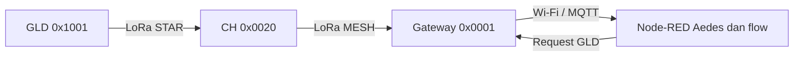

# Panduan PC baru: GLD → CH → Gateway → Node-RED

Dokumen ini adalah panduan repository tanpa rahasia. PDF ilustrasi yang
dibagikan secara privat dapat memuat kredensial MQTT; jangan commit PDF itu
atau file `.env` ke Git.



Nilai ID di atas adalah contoh bench, bukan keharusan untuk semua unit.

## 1. Persiapan dan pull

1. Siapkan Windows, Git, Node.js/npm, Node-RED, driver USB/CH340 yang diperlukan,
   jaringan Wi-Fi 2,4 GHz, kabel data, antena, dan perangkat GLD/CH/Gateway.
2. Siapkan **GLD key ID dan AES key** asli yang sesuai dengan perangkat. File
   lokal `.env` dan kredensial tidak ikut `git pull`.
3. Untuk checkout baru:

   ```powershell
   git clone https://github.com/fadlurrahmanf/PertaminaGLD.git
   cd PertaminaGLD
   git switch master
   git pull --ff-only origin master
   ```

   Untuk checkout lama, jalankan `git status --short` terlebih dahulu dan
   selesaikan perubahan lokal sebelum `git pull --ff-only origin master`.
4. Jalankan `node server/nodered/apply-pertamina-gld-flow.js --check`;
   hasil yang diharapkan `drift: false`.

## 2. Kunci GLD lokal

1. Siapkan file **`server/nodered/.env`** di PC baru, UTF-8 tanpa BOM, berisi
   `GLD_KEY_ID` dan `GLD_AES128_KEY_HEX` yang benar. Key AES adalah 32 karakter
   heksadesimal. Jangan membuat key acak jika GLD sudah diprovisioning dengan
   key lain; jangan memasukkan key ke flow JSON atau Git.
2. Pastikan `settings.js` Node-RED untuk user Windows saat ini sudah ada; mulai
   Node-RED sekali jika perlu. Dari root repository jalankan:

   ```powershell
   node server/nodered/configure-local-gld-env.js
   ```

3. Skrip mencadangkan `settings.js` dan memasang pembaca key lokal. Restart
   Node-RED. Untuk lokasi khusus gunakan `--user-dir` dan `--env-file`.
   `PGL_COMMAND_AUTH_TOKEN` juga diperlukan untuk downlink terautentikasi.

## 3. Node-RED dan Aedes

1. Jika Node-RED belum tersedia, instal dengan `npm install -g node-red`.
   Jalankan `node-red`, lalu buka `http://127.0.0.1:1880`.
2. Di menu **Manage palette → Install**, pasang `node-red-contrib-aedes`
   versi 1.2.0. Import tidak memasang modul atau menyalin kredensial.
3. Import `server/nodered/pertamina-gld-server.flow.json`. Buka node **Aedes
   MQTT broker**, pilih port 1883, lalu isi username dan password yang telah
   disepakati. Gunakan password yang diberikan secara privat; jangan biarkan
   kredensial kosong.
4. Edit konfigurasi **Pertamina GLD MQTT**: host `127.0.0.1`, port sama dengan
   Aedes, username/password sama. Deploy dan pastikan klien MQTT connected.
   Jika port 1883 dipakai broker lain, pilih port bebas seperti 1885 dan pakai
   port tersebut secara konsisten di Node-RED dan Gateway.
5. Pastikan `functionExternalModules: true`. Untuk rute CH persisten, tambahkan
   named context store `pglTopologyFile` seperti contoh `handover/state/nodered/settings.js`,
   tanpa mengganti pengaturan pengguna yang lain. Restart setelah mengubah
   `settings.js`; atur replay state/log ke lokasi privat yang tetap.
6. Gunakan `ipconfig` untuk mencari IPv4 LAN PC Node-RED. Pastikan firewall dan
   jaringan mengizinkan Gateway menjangkau port Aedes. Aedes adalah broker di
   Node-RED; broker lokal lama Operator Hub bukan broker untuk alur ini.

## 4. Upload lewat Operator Hub

1. Jalankan `apps/operator-hub/run-operator-hub.bat`, buka
   `http://127.0.0.1:5173`, dan periksa preflight runtime, uploader, driver,
   serta paket.
2. Pilih **Simple** atau **Expert Console**, pilih perangkat dan COM yang benar,
   lalu buka **Firmware Upload**.

   | Board | CH | Gateway non-TLS |
   |---|---|---|
   | V1 rectangle | CH V1 | GW V1 |
   | V2 circle | CH V2 | GW V2 |
   | V3 rectangle / WDT | CH V3 | GW V3 |

3. Periksa paket sebelum upload; tunggu keberhasilan dan verifikasi hash.
   Biarkan **Reset NVS** tidak dicentang jika konfigurasi perlu dipertahankan.
   Firmware awal di Simple dapat mewajibkan reset; ikuti pesan dan persiapkan
   provisioning ulang. Upload berhasil belum berarti jaringan terhubung.
4. GW V2 dan CH V3 pernah diuji fisik. GW V1/V3 dan CH V1/V2 masih perlu uji
   fisik. Kandidat CH saat ini beridentitas firmware 0.8.0/protokol 0.2.0;
   jangan menganggapnya setara firmware 0.10.0 tanpa bukti dan cadangan.
5. Untuk GLD, pilih paket yang sesuai model dan mode unit. Pertahankan firmware
   yang sudah bekerja bila tidak perlu upload. Reset dapat menghapus key dan
   konfigurasi sehingga provisioning/nulling perlu diulangi.

## 5. Konfigurasi Gateway, CH, dan GLD

1. Di **Expert Gateway → Gateway Setup**, pilih COM lalu **Connect**. Verifikasi
   ID Gateway; contoh ini `0001`.
2. Simpan Wi-Fi, tunggu reboot/reconnect, dan klik **Test Gateway Wi-Fi**.
   PC server dan Gateway harus dapat saling menjangkau.
3. Di bagian MQTT, pilih non-TLS untuk Aedes bench; isi IPv4 PC Node-RED,
   port Aedes, username/password Aedes, dan root `gld/gateway`. Pada PC baru
   isi sekali dan klik **Test broker from this PC**. Setelah tes berhasil,
   **Use This PC IP** juga dapat mengisi profil yang disimpan terenkripsi bagi
   user Windows tersebut. Tombol ini hanya tepat jika Operator dan Node-RED
   berada di PC yang sama. Klik **Save & connect Gateway**.
4. Di **Expert CH → Settings**, set CH ID `0020` dan Root Gateway ID `0001`;
   tunggu reboot dan pastikan **JOINED**, parent `0x0001`.
5. Contoh pengaturan bench: STAR GLD–CH `920.0 MHz`, `125 kHz`, `SF7`,
   `CR 4/5`, sync `18` (`0x12`); MESH CH–Gateway `921.0 MHz`, `125 kHz`,
   `SF9`, `CR 4/5`, sync `52` (`0x34`). Cocokkan kedua ujung; jangan mengubah
   nilai lapangan yang sudah ditentukan tanpa koordinasi.
6. Pada GLD set Target CH `0020`, identitas GLD unik misalnya `1001`, dan AES
   yang sama dengan server. Di Expert CH → **Nodes (GLD)** gunakan **Refresh
   (GET_NODES)** dan periksa identitas serta usia data GLD.

## 6. Tes end-to-end

1. Buka `http://127.0.0.1:1880/pertamina-gld/topology/view` pada PC Node-RED.
   Pastikan GW `0x0001` dan CH `0x0020` muncul dengan parent yang benar.
2. Tekan **Request GLD** pada kartu CH. Pada panel kiri periksa request ID,
   `DATA_OK` dan jumlah record. Record diterima belum membuktikan dekripsi.
3. Panel **GLD Terdiscover** harus menampilkan GLD `0x1001`, CH `0x0020`,
   data terbaru dan decode OK. Ulangi dengan jeda agar GLD mengirim data baru.
4. `DATA_EMPTY` / 0 record berarti CH menjawab tetapi tidak punya data baru
   yang belum dikirim. `DATA_OK` tetapi kartu kosong dapat berarti key AES/key
   ID salah atau tidak dimuat; periksa `gld/gateway/error`, lokal `.env`, dan
   restart Node-RED. Jangan menganggap record yang gagal autentikasi sebagai
   data yang valid.
5. Timeout atau CRC `-7` berarti radio belum andal; periksa kedua sisi, antena,
   frekuensi, interferensi dan sinyal. Retry terbatas mengurangi kehilangan
   tetapi tidak menjamin setiap permintaan berhasil.

Pengujian checkout bersih dan bench tidak menggantikan uji fisik setiap varian,
instalasi jaringan PC lain, atau pemantauan keandalan jangka panjang.
